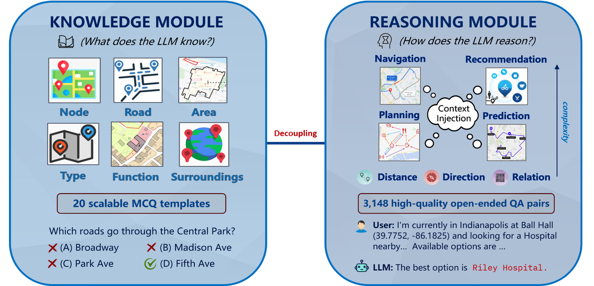

# UrbanGeoEval

**A City-Scale Benchmark for Evaluating Large Language Models in Geospatial Reasoning**

**ACL 2026 Main Conference · Long Papers**

[ACL paper](https://aclanthology.org/2026.acl-long.1867/) · [Hugging Face collection](https://huggingface.co/collections/SkyyyyyMT/urbangeoeval) · [Knowledge dataset](https://huggingface.co/datasets/SkyyyyyMT/UrbanGeoEval-choice) · [Reasoning dataset](https://huggingface.co/datasets/SkyyyyyMT/UrbanGeoEval-reason) · [Quickstart](#evaluation-quickstart) · [Citation](#citation)

## Benchmark overview

UrbanGeoEval is a benchmark for evaluating **urban geospatial intelligence in large language models**: how well models know cities, interpret geographic information, and solve spatial problems in realistic urban environments. It spans points of interest, road networks, and urban areas, connecting foundational spatial skills with applications such as itinerary planning, navigation, and location-based recommendation.

The benchmark separates **geographic knowledge** from **geospatial reasoning**, making it possible to diagnose whether a model struggles to recall urban facts or to reason with the information it is given. Its two complementary modules combine broad geographic coverage with fine-grained evaluation of spatial capabilities.

<p align="center">
  
</p>

*Figure 1. A geographic knowledge error can lead to a subsequent reasoning error.*

- **Knowledge: urban knowledge across 18 cities and 6 continents.** OpenStreetMap-derived multiple-choice questions cover six dimensions—nodes, areas, roads, types, functions, and surroundings—through 20 question templates, probing geographic precision, entity attributes, and spatial relationships.
- **Reasoning: foundational skills through complex spatial decisions.** Seven task families cover distance, direction, spatial relations, itinerary planning, trajectory prediction, navigation, and point-of-interest recommendation. Open-ended questions provide the necessary geographic context, including coordinates and geometry, to assess spatial computation and inference independently of factual recall.
- **Evaluation: reasoning quality and answer correctness.** The paper combines task-specific programmatic checks with rubric-guided LLM judging to assess both the reasoning process and the final answer. This supports analysis of geographic biases, knowledge granularity, and the foundational spatial skills underlying more complex tasks.

<p align="center">
  
</p>

*Figure 2. The Knowledge module generates multiple-choice questions, and the Reasoning module supplies context for open-ended spatial problems.*

## Datasets

| Module | Hugging Face | Release size | Local evaluation inputs |
| --- | --- | ---: | --- |
| **Knowledge** | [UrbanGeoEval-choice](https://huggingface.co/datasets/SkyyyyyMT/UrbanGeoEval-choice) | 113,851 questions · 18 cities across 6 continents, 20 question templates |
| **Reasoning** | [UrbanGeoEval-reason](https://huggingface.co/datasets/SkyyyyyMT/UrbanGeoEval-reason) | 3,163 questions across 7 task families |


## Leaderboard

Results from the [ACL 2026 paper](https://aclanthology.org/2026.acl-long.1867/), ranked separately for each module. Higher is better for all scores.

### Knowledge

Accuracy (%) across six knowledge dimensions, averaged across 18 cities (Table 4).

| Rank | Model | Node | Area | Road | Type | Function | Surroundings | Overall |
| ---: | --- | ---: | ---: | ---: | ---: | ---: | ---: | ---: |
| 1 | GPT-4o | 38.83 | 68.18 | 59.59 | 76.15 | 53.29 | 28.89 | **54.59** |
| 2 | Qwen2.5-72B-Instruct | 30.94 | 59.25 | 36.54 | 78.86 | 53.56 | 27.11 | **47.64** |
| 3 | Llama-3.1-70B-Instruct | 30.05 | 56.02 | 38.24 | 77.63 | 49.09 | 22.55 | **45.71** |
| 4 | Qwen2.5-7B-Instruct | 23.65 | 46.97 | 28.57 | 74.28 | 48.60 | 25.46 | **40.57** |
| 5 | Llama-3.1-8B-Instruct | 22.96 | 45.48 | 28.03 | 66.69 | 32.04 | 20.43 | **35.89** |

### Reasoning

Average total score on a normalized 0–100 scale, incorporating reasoning-process and final-answer scores across seven task families (Figure 3).

| Rank | Model | Overall score |
| ---: | --- | ---: |
| 1 | Qwen3.5-397B-A17B | **85.6** |
| 2 | o3-mini | 85.3 |
| 3 | Qwen3-32B | 82.1 |
| 4 | MiniMax-M2.5 | 81.2 |
| 5 | QwQ-32B | 80.1 |
| 6 | DeepSeek-R1 | 78.2 |
| 7 | DeepSeek-V3 | 75.5 |
| 8 | GPT-4o | 74.3 |
| 9 | Qwen3-8B | 73.6 |
| 10 | Qwen2.5-72B-Instruct | 69.4 |
| 11 | Phi-4 | 69.1 |
| 12 | DeepSeek-R1-32B | 67.4 |
| 13 | Gemma-3-27B | 67.2 |
| 14 | Llama-3.1-70B-Instruct | 65.1 |
| 15 | Qwen2.5-7B-Instruct | 57.6 |
| 16 | Llama-3.1-8B-Instruct | 55.2 |
| 17 | DeepSeek-R1-7B | 49.6 |
| 18 | DeepSeek-R1-1.5B | 37.3 |

## Evaluation quickstart

Use Python 3.12+ and run from the repository root. Configure an OpenAI-compatible endpoint with `OPENAI_BASE_URL` (default: `http://localhost:8001/v1`) and `OPENAI_API_KEY` if required.

```bash
python -m pip install -r requirements.txt

# Knowledge
python -m evaluate.urban_eval.eval_qa_choice \
  --city_name Berlin --model_name your-model-id

# Reasoning
export MODEL_NAME=your-model-id
export JUDGE_MODEL_NAME=your-judge-model-id
python -m evaluate.urban_eval.eval_qa_reason --task distance
```

Use `--city_name all` or `--task all` for full coverage. Reasoning supports LLM judging and `--program` to rescore saved distance, direction, and planning answers with judge-assisted extraction. Results are saved under `evaluate/urban_eval/results/`; see each script's `--help` for more options.

## Citation

```bibtex
@inproceedings{bao-etal-2026-urbangeoeval,
  title     = "{UrbanGeoEval}: A City-Scale Benchmark for Evaluating Large Language Models in Geospatial Reasoning",
  author    = "Bao, Mutian and Qi, Qiuyi and Liang, Tian and Zhang, Jinjian and
               Zhou, Wei and Kong, Ming and Mo, Linjian and Zhu, Qiang",
  booktitle = "Proceedings of ACL 2026 (Volume 1: Long Papers)",
  year      = "2026",
  pages     = "40183--40223",
  publisher = "Association for Computational Linguistics",
  doi       = "10.18653/v1/2026.acl-long.1867",
  url       = "https://aclanthology.org/2026.acl-long.1867/"
}
```
