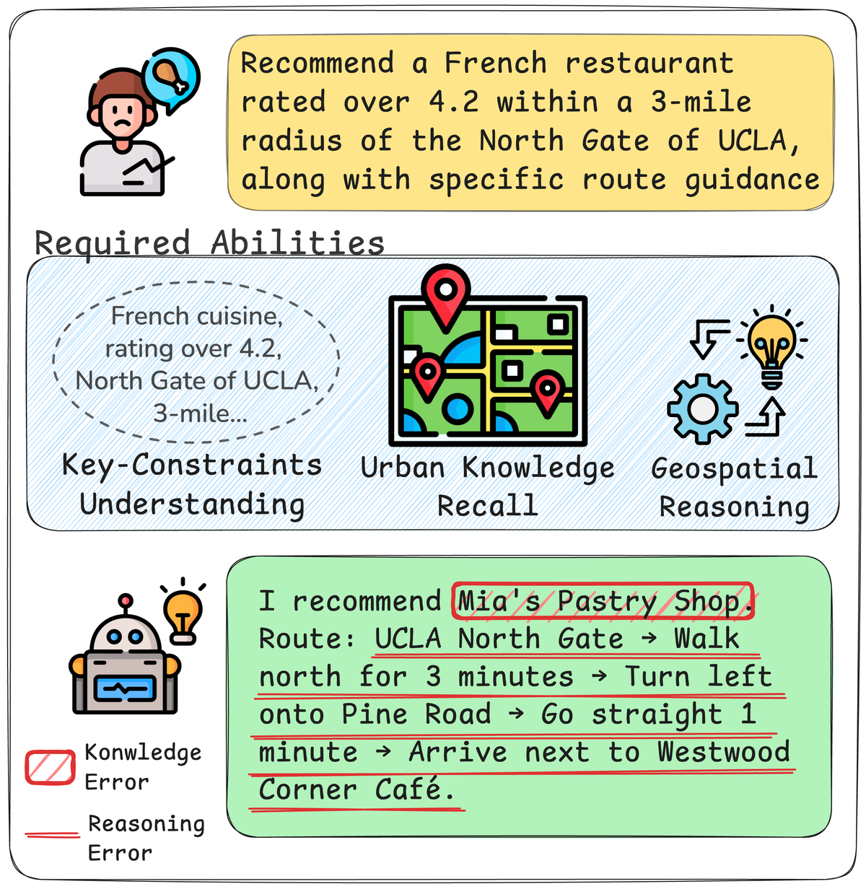

# UrbanGeoEval

**A City-Scale Benchmark for Evaluating Large Language Models in Geospatial Reasoning**

**ACL 2026 Main Conference · Long Papers**

[ACL paper](https://aclanthology.org/2026.acl-long.1867/) · [Hugging Face collection](https://huggingface.co/collections/SkyyyyyMT/urbangeoeval) · [Choice dataset](https://huggingface.co/datasets/SkyyyyyMT/UrbanGeoEval-choice) · [Reason dataset](https://huggingface.co/datasets/SkyyyyyMT/UrbanGeoEval-reason) · [Quickstart](#evaluation-quickstart) · [Citation](#citation)

## Benchmark overview

A model can get a route wrong because it recalls a nonexistent place or because it misreads the road network. UrbanGeoEval evaluates those abilities separately at the city scale.

<p align="center">
  
</p>

*Figure 1. A geographic knowledge error can lead to a subsequent reasoning error.*

- **Knowledge (Choice)** measures recall of urban facts through multiple-choice questions derived from OpenStreetMap. The questions cover points of interest, roads, areas, place types, urban functions, and surroundings.
- **Reasoning (Reason)** supplies the geographic context needed for open-ended tasks. It covers distance, direction, spatial relations, itinerary planning, trajectory prediction, navigation, and point-of-interest recommendation.

<p align="center">
  
</p>

*Figure 2. The Knowledge module generates multiple-choice questions, and the Reasoning module supplies context for open-ended spatial problems. Figures are reproduced from [Bao et al. (ACL 2026)](https://aclanthology.org/2026.acl-long.1867/) under [CC BY 4.0](https://creativecommons.org/licenses/by/4.0/).*

## Datasets

| Module | Hugging Face | Release size | Local evaluation inputs |
| --- | --- | ---: | --- |
| **Knowledge (Choice)** | [UrbanGeoEval-choice](https://huggingface.co/datasets/SkyyyyyMT/UrbanGeoEval-choice) | 113,851 questions | [`urban_data/geoqa_choice/`](urban_data/geoqa_choice) · 18 cities across 6 continents, 20 question templates |
| **Reasoning (Reason)** | [UrbanGeoEval-reason](https://huggingface.co/datasets/SkyyyyyMT/UrbanGeoEval-reason) | 3,163 questions | [`urban_data/geoqa_reason/`](urban_data/geoqa_reason) · 3,148 questions across 7 task families |

Each Hugging Face release is a single JSONL file. The scripts below read the local per-task files. The paper reports about 54,000 Knowledge questions in Table 1 and 3,148 Reasoning questions in Table 3.

## Results in the paper

Table 4 reports results for five Knowledge models, with GPT-4o leading at **54.59% accuracy**. Figure 3 compares 18 Reasoning models, with Qwen3.5-397B-A17B leading at **85.6/100**. These are scores from the [paper's evaluation](https://aclanthology.org/2026.acl-long.1867/).

## Evaluation quickstart

Run the commands from the repository root in a Python 3.12 environment.

```bash
python -m pip install -r requirements.txt
```

The scripts call an OpenAI-compatible Chat Completions endpoint. The default is `http://localhost:8001/v1`. Set `OPENAI_BASE_URL` for a different endpoint and `OPENAI_API_KEY` if it requires authentication. Use the model IDs advertised by that endpoint.

### Knowledge (Choice)

```bash
python -m evaluate.urban_eval.eval_qa_choice \
  --city_name Berlin --model_name your-model-id
```

Use `--city_name all` for all 18 cities. `--max_valid` determines the sample size for task files with more than twice that many questions. Per-task accuracy, response logs, and checkpoints are saved under `evaluate/urban_eval/results/geoqa_choice/`.

### Reasoning (Reason)

```bash
export MODEL_NAME=your-model-id
export JUDGE_MODEL_NAME=your-judge-model-id
python -m evaluate.urban_eval.eval_qa_reason --task distance
```

The LLM judge scores the reasoning process and final answer separately using the task-specific [rubrics](evaluate/urban_eval/reason_prompt.py). Use `--task all` to evaluate the full local Reasoning set. Results are saved under `evaluate/urban_eval/results/geoqa_reason/<model>/`.

To recompute answer scores for saved distance, direction, and planning responses, run the programmatic scoring pass.

```bash
python -m evaluate.urban_eval.eval_qa_reason --program
```

This pass uses the judge to extract answer values and preserves the existing reasoning score. The released script uses circular bearing error for direction and Levenshtein edit distance for planning. Use `--fix` to retry incomplete judge scores or `--fix --overwrite` to rejudge all saved responses.

## Citation

```bibtex
@inproceedings{bao-etal-2026-urbangeoeval,
  title     = "{UrbanGeoEval}: A City-Scale Benchmark for Evaluating Large Language Models in Geospatial Reasoning",
  author    = "Bao, Mutian and Qi, Qiuyi and Liang, Tian and Zhang, Jinjian and
               Zhou, Wei and Kong, Ming and Mo, Linjian and Zhu, Qiang",
  booktitle = "Proceedings of ACL 2026 (Volume 1: Long Papers)",
  year      = "2026",
  pages     = "40183--40223",
  publisher = "Association for Computational Linguistics",
  doi       = "10.18653/v1/2026.acl-long.1867",
  url       = "https://aclanthology.org/2026.acl-long.1867/"
}
```
